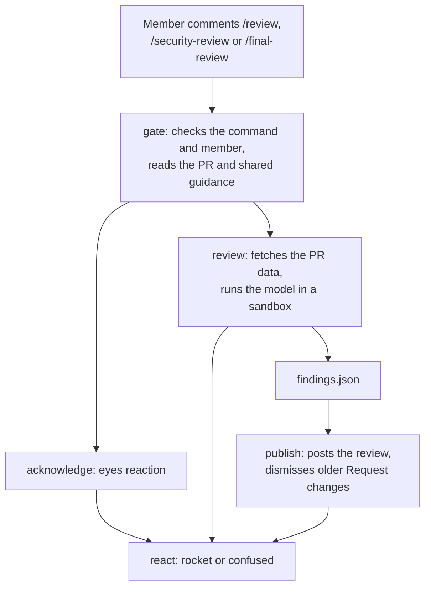

# On-demand AI review

Start with [`scripts/__main__.sh`](scripts/__main__.sh) to see which script
handles each operation in the [AI review workflow](../../workflows/reusable-bot-ai-review.yml).
For setup, commands, and model configuration, see [On-Demand AI Review](../../../README.rst#on-demand-ai-review).

## Flow



## Layout

- `scripts/`: `__main__.sh` dispatches each workflow step by name. Step
  implementations and helpers, including the scripts installed into the
  sandbox, sit beside it.
- `prompts/shared/`: prompt parts used by every review.
- `prompts/stages/`: the prompt of each review stage.
- `opencode.json`: OpenCode configuration (tool permissions and allowed
  commands).
- `tests/`: tests for the review scripts.

## Jobs and entry-point commands

Each subcommand runs the same-named shell script in `scripts/`. For example,
`bash scripts/__main__.sh parse-command` runs `scripts/parse-command.sh`.

| Job           | Subcommand              | Result                                                     |
| ------------- | ----------------------- | ---------------------------------------------------------- |
| `gate`        | `parse-command`         | Review stage, model, and optional reasoning effort outputs |
| `gate`        | `read-pull-request`     | Head and base commit outputs                               |
| `gate`        | `fetch-shared-guidance` | `shared-guidance/guidance.md` and `notes.md` artifact      |
| `acknowledge` | Inline `gh api` call    | Eyes reaction and its ID                                   |
| `review`      | `fetch-pull-request`    | PR copy, `pr.diff`, and `guidance.md`                      |
| `review`      | `fetch-threat-model`    | `threat-model.rst` for `/review` only                      |
| `review`      | `prepare-sandbox`       | `reviewer` user and sandbox scripts                        |
| `review`      | `configure-credentials` | Provider credentials under `$RUNNER_TEMP/opencode-data/`   |
| `review`      | `fetch-history`         | `history.json` and `context.json`                          |
| `review`      | `run-review`            | `findings.json` artifact                                   |
| `publish`     | `install-crit`          | Installs Crit only when the review has inline comments     |
| `publish`     | `publish`               | GitHub review and dismissal of superseded change requests  |
| `react`       | `update-reaction`       | Final reaction when the eyes reaction was added            |

The review job keeps the diff and other model inputs in `/tmp/ai-review/data/`,
outside the PR copy in `/tmp/ai-review/pr/`. It writes `findings.json` under
`$RUNNER_TEMP`, then uploads it for the publish job.

## Prompt

`scripts/build-prompt.sh` joins the prompt in this order:

1. `prompts/shared/context.md`, with the time limit filled in.
2. `prompts/stages/<n>-<stage>.md`.
3. The shared AI guidance from `openwisp-opencode-configs`.
4. `prompts/shared/verification.md`.

## Sandbox

- Every shell command of the model runs through `sandbox-shell.sh` as the
  `reviewer` user, without `sudo`.
- The model reads and edits `/tmp/ai-review/pr/`. Its shell commands run in
  `/tmp/ai-review/run/`. The sync copies files only from the model's copy
  to the command copy, so files generated by tests do not appear in the
  model's copy.
- Before each command, `sync-copy.sh` copies the model's edits to the command
  copy and removes files deleted from the model's copy.

## Local checks

For local checks and dependencies, see [Development](../../../README.rst#development).
To run just the review tests from the repository root:

```shell
python -m pytest .github/actions/bot-ai-review/tests -q
```
