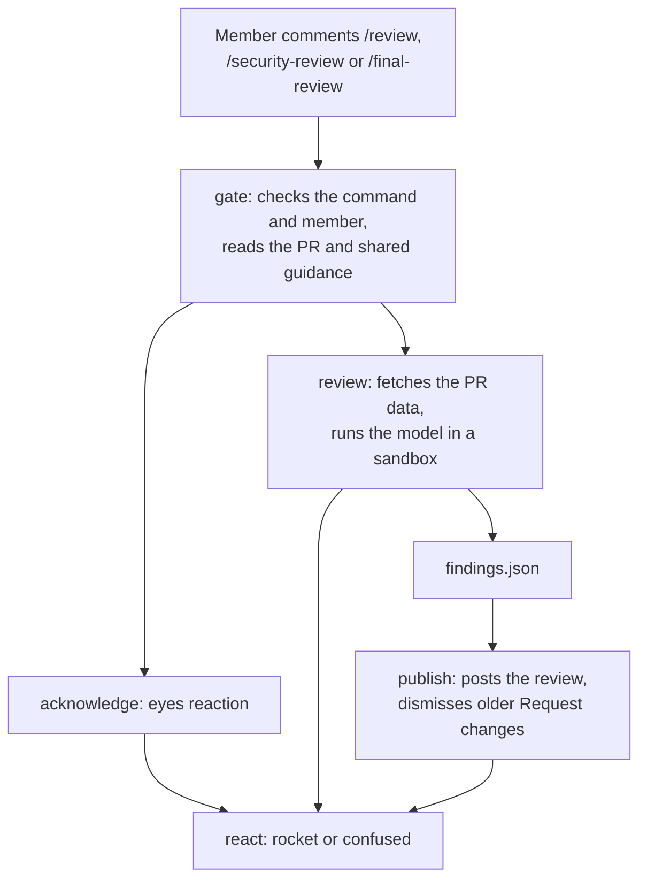

# On-demand AI review

Scripts, prompts and configuration used by
`.github/workflows/reusable-bot-ai-review.yml`. Usage and configuration are
documented in the repository `README.rst`; this file explains how the
pieces fit together.

## Flow

## Layout

- `scripts/`: entry points, each one run by a workflow step.
- `scripts/lib/`: helpers called by the entry points.
- `scripts/sandbox/`: scripts installed into the sandbox, used by the
  model's shell commands.
- `prompts/shared/`: prompt parts used by every review.
- `prompts/stages/`: the prompt of each review stage.
- `opencode.json`: OpenCode configuration (tool permissions and allowed
  commands).
- `tests/`, `tests/lib/`, `tests/sandbox/`: tests, mirroring `scripts/`.

## Jobs and entry points

| Job           | Step                                     | Entry point                | Calls                                                          | Writes                                               |
| ------------- | ---------------------------------------- | -------------------------- | -------------------------------------------------------------- | ---------------------------------------------------- |
| `gate`        | Parse command                            | `parse-command.sh`         |                                                                | `stage`, `model` outputs                             |
| `gate`        | Read pull request                        | `read-pull-request.sh`     |                                                                | `head_sha`, `base_sha` outputs                       |
| `gate`        | Fetch shared AI guidance                 | `fetch-shared-guidance.sh` | `lib/shared_guidance.py`                                       | `shared-guidance/guidance.md`, `notes.md` (artifact) |
| `acknowledge` | Add eyes reaction                        | inline `gh api`            |                                                                | `reaction_id` output                                 |
| `review`      | Fetch pull request as data               | `fetch-pull-request.sh`    | `lib/guidance.py`                                              | `/tmp/ai-review/pr/`, `pr.diff`, `guidance.md`       |
| `review`      | Fetch threat model (`/review` only)      | `fetch-threat-model.sh`    |                                                                | `threat-model.rst`                                   |
| `review`      | Prepare sandbox user                     | `prepare-sandbox.sh`       | installs `sandbox/sandbox-shell.sh` and `sandbox/sync-copy.sh` | `reviewer` user                                      |
| `review`      | Configure provider credentials           | `configure-credentials.sh` |                                                                | `$RUNNER_TEMP/opencode-data/`                        |
| `review`      | Fetch pull request discussion            | `fetch-history.sh`         | `lib/history.graphql`, `lib/history.py`, `lib/context.py`      | `history.json`, `context.json`                       |
| `review`      | Run review                               | `run-review.sh`            | `lib/build-prompt.sh`, `lib/extract_findings.py`               | `findings.json` (artifact)                           |
| `publish`     | Install Crit (only with inline comments) | `install-crit.sh`          |                                                                | `crit`                                               |
| `publish`     | Publish review                           | `publish.sh`               |                                                                | the review on GitHub                                 |
| `react`       | Replace eyes reaction                    | `update-reaction.sh`       |                                                                | the final reaction                                   |

Unless stated otherwise, the review data is stored in `/tmp/ai-review/data/`,
outside the pull request copy in `/tmp/ai-review/pr/`.

## Prompt

`lib/build-prompt.sh` joins the prompt in this order:

1. `prompts/shared/context.md`, with the time limit filled in.
2. `prompts/stages/<n>-<stage>.md`.
3. The shared AI guidance from `openwisp-opencode-configs`.
4. `prompts/shared/verification.md`.

## Sandbox

- Every shell command of the model runs through `sandbox-shell.sh` as the
  `reviewer` user, without `sudo`.
- The model reads and edits the pull request in one copy, and commands run
  in a second copy. Files created by the pull request's code, such as a
  symlink to the credentials, stay in the second copy and can never be
  opened by the model's file tools, which can read the credentials.
- Before each command, `sync-copy.sh` copies the model's latest edits to
  the second copy and removes the files it deleted, so commands always run
  on the same code the model sees.
